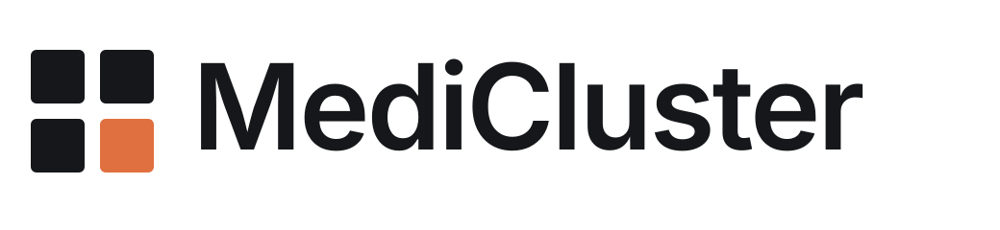
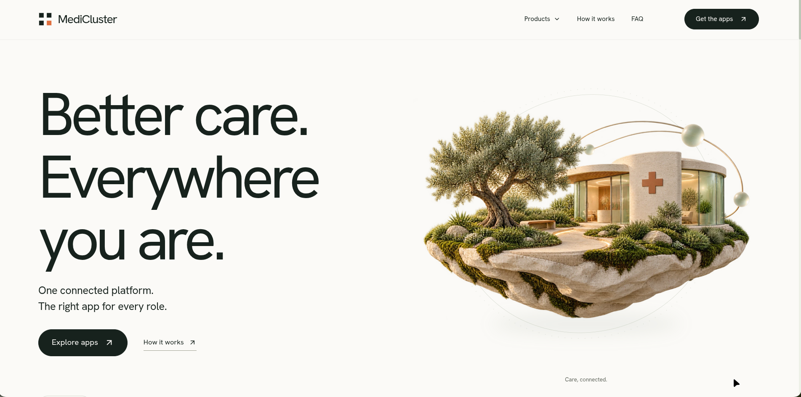
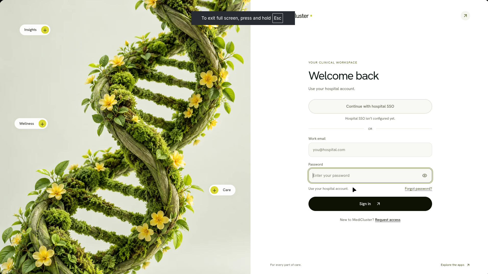
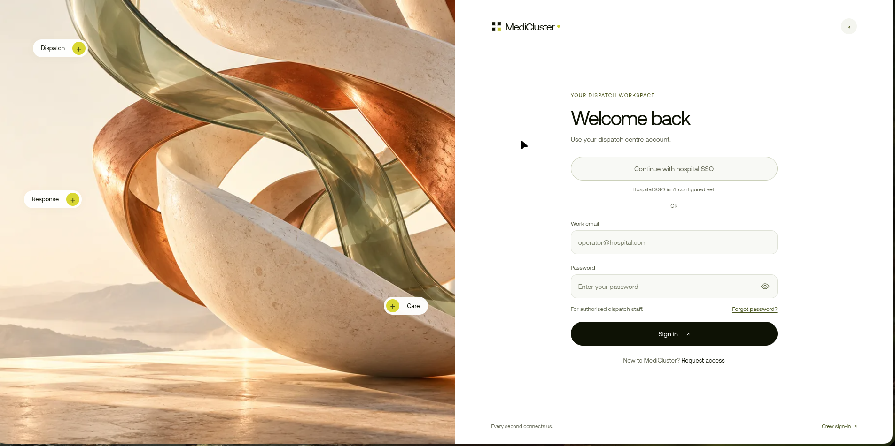
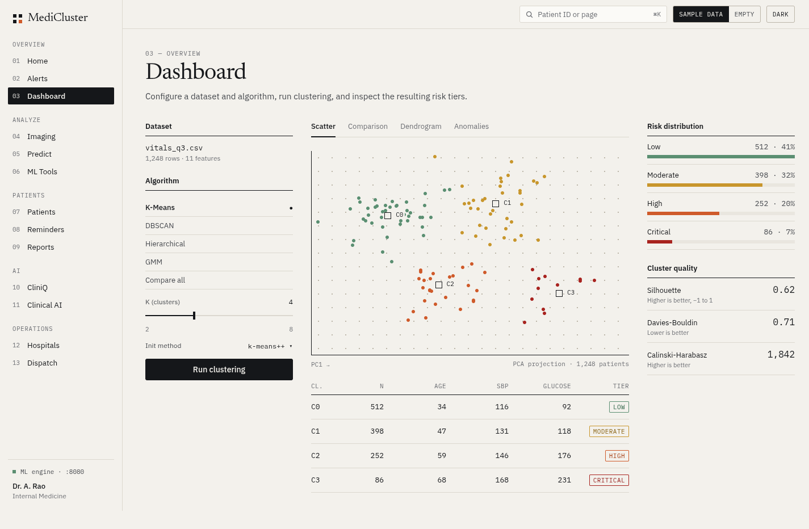
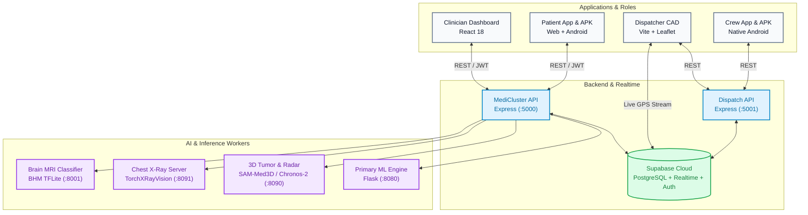
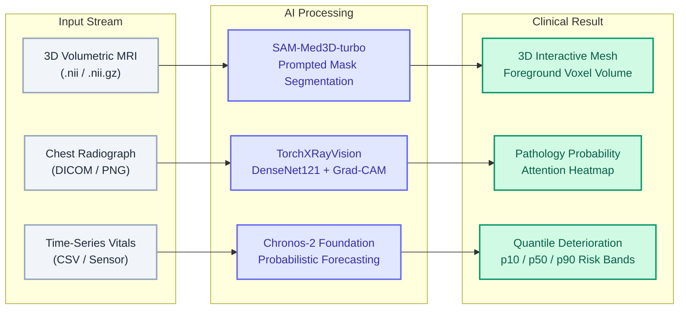

<div align="center">

<picture>
  <source media="(prefers-color-scheme: dark)" srcset="docs/images/medicluster-logo-dark.png">
  <source media="(prefers-color-scheme: light)" srcset="docs/images/medicluster-logo-light.png">
  
</picture>

### Next-Gen Unified Healthcare Platform & Emergency Dispatch Ecosystem

[](https://react.dev/)
[](https://www.typescriptlang.org/)
[](https://nodejs.org/)
[](https://python.org/)
[](https://pytorch.org/)
[](https://supabase.com/)
[](https://developer.android.com/)
[](https://www.docker.com/)
[](LICENSE)

</div>

---

## ⚡ Overview

**MediCluster** bridges acute emergency dispatch and hospital clinical workflows into a single cohesive ecosystem. It unifies patient engagement, CAD ambulance routing, native mobile apps, and state-of-the-art diagnostic deep learning.

### 👥 Role-Driven Ecosystem

| Role | Portal / Application | Capabilities |
| :--- | :--- | :--- |
| **🩺 Clinicians** | Web EMR Dashboard (`:3000`) | Patient timeline, 3D SAM-Med3D tumor volumetrics, Chronos-2 vital radar, Grad-CAM X-Ray analysis |
| **👤 Patients** | Web Portal (`:3000/app`) + Native APK | Clinic OTP/SSO login, records history, appointments, live vitals |
| **🚨 Dispatchers** | CAD Operations Console (`:5174`) | Real-time map tracking, automated unit recommendation, GPS dispatch |
| **🚑 Crews** | Dedicated Android APK + Web (`:5174/#/driver`) | Employee ID/PIN auth, turn-by-turn routing, pre-hospital vitals transfer |

---

## 🖥️ Platform Showcase

<table width="100%">
  <tr>
    <td width="50%" align="center">
      <b>🌐 Role Gateway & Landing</b>
      <br/><br/>
      
    </td>
    <td width="50%" align="center">
      <b>🩺 Clinical Workspace</b>
      <br/><br/>
      
    </td>
  </tr>
  <tr>
    <td width="50%" align="center">
      <b>🚨 Dispatch Operations</b>
      <br/><br/>
      
    </td>
    <td width="50%" align="center">
      <b>📊 Clinician EMR Dashboard</b>
      <br/><br/>
      
    </td>
  </tr>
</table>

---

## 🔄 System Workflows

### 1. Emergency Dispatch & Response Lifecycle

```mermaid
flowchart LR
    classDef emergency fill:#fee2e2,stroke:#ef4444,stroke-width:2px,color:#991b1b;
    classDef dispatch fill:#ffedd5,stroke:#f97316,stroke-width:2px,color:#9a3412;
    classDef crew fill:#fef3c7,stroke:#f59e0b,stroke-width:2px,color:#92400e;
    classDef hospital fill:#ecfdf5,stroke:#10b981,stroke-width:2px,color:#065f46;
    classDef ai fill:#ede9fe,stroke:#8b5cf6,stroke-width:2px,color:#5b21b6;

    A["🚨 Incident Call<br/>Citizen / 911"]:::emergency --> B["🖥️ CAD Dispatch<br/>Triage & Unit Recommendation"]:::dispatch
    B --> C["🚑 Crew En-Route<br/>Android GPS Telemetry"]:::crew
    C --> D["🩹 Scene Care<br/>Pre-Hospital Vitals Sync"]:::crew
    D --> E["🏥 Hospital Intake<br/>Clinician EMR Handover"]:::hospital
    E --> F["🧠 AI Risk & Imaging<br/>SAM-Med3D & Chronos-2"]:::ai
```



### 2. Unified Platform Architecture & Data Flow



### 3. Diagnostic AI Pipelines



---

## 📁 Repository Structure

```text
├── medicluster/
│   ├── frontend/             # Clinician dashboard & Patient portal (React 18 + Vite)
│   ├── backend/              # Node/Express API with Supabase Auth & JWT
│   ├── ml-engine/            # Tabular risk models, NLP, TorchXRayVision CXR
│   ├── intelligence-engine/  # SAM-Med3D-turbo & Chronos-2 Deterioration Radar
│   ├── patient-android/      # Native patient Android application
│   └── crew-android/         # Native crew Android application
└── ambulance-dispatch/
    ├── frontend/
    │   └── dispatcher-dashboard/ # Dispatcher CAD console & Crew web workspace
    └── backend/
        └── api/              # Dispatch REST API & Supabase assignment services
```

---

## 🚀 Quickstart

### Service Registry & Ports

| Component | Directory | Port | Command |
| :--- | :--- | :--- | :--- |
| **ML Engine** | `medicluster/ml-engine` | `:8080` | `source venv/bin/activate && python app.py` |
| **Backend API** | `medicluster/backend` | `:5000` | `npm run dev` |
| **Web Frontend** | `medicluster/frontend` | `:3000` | `npm run dev` |
| **Dispatch CAD** | `ambulance-dispatch/frontend/dispatcher-dashboard` | `:5174` | `npm run dev` |
| **Dispatch API** | `ambulance-dispatch/backend/api` | `:5001` | `npm start` |

### 1. Backend & ML Setup

```bash
# 1. ML Engine
cd medicluster/ml-engine
python3 -m venv venv && source venv/bin/activate
pip install -r requirements.txt
python app.py
```

```bash
# 2. Node Backend
cd medicluster/backend
cp .env.example .env   # Configure SUPABASE_URL, SUPABASE_SECRET_KEY, JWT_SECRET
npm ci
npm run dev
```

```bash
# 3. Frontend App
cd medicluster/frontend
npm ci
npm run dev
```

> [!TIP]
> Access points: Clinicians at `http://localhost:3000/login`, Patients at `http://localhost:3000/app`.

---

### 2. Ambulance Dispatch Setup

```bash
# 1. Dispatch CAD Console
cd ambulance-dispatch/frontend/dispatcher-dashboard
npm ci
npm run dev
```

```bash
# 2. Dispatch REST API
cd ambulance-dispatch/backend/api
npm ci
npm start
```

> [!NOTE]
> Access points: Dispatchers at `http://localhost:5174/#/login`, Ambulance Crews at `http://localhost:5174/#/driver/login`.

---

## 🔬 Deep Learning Workstations

<details>
<summary><b>🧠 3D Tumor Explorer (SAM-Med3D) & Deterioration Radar (Chronos-2)</b></summary>

<br/>

Requires local intelligence worker running on `127.0.0.1:8090`:

```bash
cd medicluster/intelligence-engine
.venv/bin/python app.py
```

- Configure matching `INTELLIGENCE_TOKEN` in `medicluster/backend/.env` and `medicluster/intelligence-engine/.env`.
- Set `INTELLIGENCE_URL=http://127.0.0.1:8090` in `medicluster/backend/.env`.
- **3D Tumor**: Interactive axial lesion prompt placement $\rightarrow$ 3D mesh reconstruction $\rightarrow$ Foreground voxel volume analysis.
- **Radar**: Multi-signal vital telemetry replay $\rightarrow$ Chronos-2 probabilistic forecast (10th, 50th, 90th percentiles).
</details>

<details>
<summary><b>🩻 Chest X-Ray Worker (TorchXRayVision)</b></summary>

<br/>

Dedicated Python 3.12 imaging service on `127.0.0.1:8091`:

```bash
cd medicluster/ml-engine
uv venv --python 3.12 .venv-imaging
uv pip install --python .venv-imaging/bin/python -r requirements-imaging.txt
.venv-imaging/bin/python download_imaging_models.py
.venv-imaging/bin/python imaging_server.py
```

Set `CHEST_IMAGING_URL=http://127.0.0.1:8091` in `medicluster/backend/.env`. Provides DenseNet-121 multi-pathology scoring and Grad-CAM attention overlays.
</details>

<details>
<summary><b>🔬 Brain MRI Health Monitor</b></summary>

<br/>

Run the TFLite 4-class classifier (Glioma, Meningioma, Pituitary, Normal):

```bash
cd /home/vinay/Documents/brain_health_monitor
BHM_HOST=127.0.0.1 BHM_PORT=8001 .venv/bin/python server.py
```

Set `BRAIN_MRI_URL=http://127.0.0.1:8001` in `medicluster/backend/.env`.
</details>

---

## 🚢 Deployment

| Target | Service Root | Type | Build / Run |
| :--- | :--- | :--- | :--- |
| **Web + Backend** | `medicluster` | Docker / Node | Multi-stage Dockerfile or separate Render Web Services |
| **ML Engine** | `medicluster/ml-engine` | Docker / Python | Gunicorn container exposing `:8080` |
| **Dispatch CAD** | `ambulance-dispatch/frontend/dispatcher-dashboard` | Static / Web | `npm ci && npm run build` $\rightarrow$ publish `dist` |
| **Dispatch API** | `ambulance-dispatch/backend/api` | Node Web Service | `npm ci && npm start` |

---

## 📄 License

Distributed under the **GNU General Public License v3.0 (GPL-3.0)**. See [`LICENSE`](file:///home/vinay/medicluster/LICENSE) for complete terms and copyleft permissions.

---

<div align="center">
  <sub>MediCluster &middot; Designed for Connected Healthcare & Emergency Response</sub>
</div>
